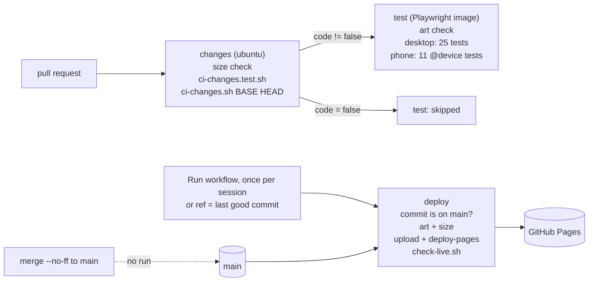

# Feature: Fewer Actions minutes, no check lost

## Problem, in a maintainer's terms

Every change paid for the same Playwright suite twice: once on its pull request and again on the
push to `main`. Then it deployed straight away. Each run also installed Chromium's system
libraries with apt, which normally takes 13–21 s and once took 16 min 52 s. The phone project
re-ran the whole suite, including tests whose result a phone cannot change. The goal is to stop
running the same test twice on the same code. Nothing that protects a visitor may be dropped or
weakened.

The repository is public. GitHub's usage API reports **0 billable ms** for these runs (standard
runners are free for public repositories), so today the saving is wall time and runner load. It
becomes quota only if the repository goes private.

## Measured before the change (2026-10-26)

Each job is billed rounded up to the whole minute.

| Run | Event | Job | Ran for | Billed |
|:--|:--|:--|:--|:--|
| #12, PR #6 head `d4d9260` | pull_request | test | 18m51s (apt install 16m52s) | 19 |
| | | deploy | skipped | 0 |
| #13, merge `40fa7e1` | push main | test | 2m09s | 3 |
| | | deploy | 9s | 1 |
| #10, PR #5 head `8f70cae` | pull_request | test | 50s | 1 |
| #11, merge `a0dd573` | push main | test | 54s | 1 |
| | | deploy | 11s | 1 |

**One ordinary change** with today's suite costs 3 (PR) + 3 (the same suite on main) + 1 (deploy)
= **7 min**, or **23 min** when the apt install stalls. Each extra push to a PR adds 3.

## Decisions

| Item | Applied? | Why |
|:--|:--|:--|
| CI on pull requests only | yes | Every first-parent commit on `main` after the initial one is a `--no-ff` merge of a PR. A PR's run tests `refs/pull/N/merge`, the merge result. |
| One full run, other legs only what they can change | yes | `desktop` runs all 25 tests. `phone` (Pixel 7) runs the 11 tagged `@device`, the ones its size, touch or lazy loading can change: what loads, console errors, visibility of the story, small-phone fit, bedtime, share, feed, owl, and both contrast tests. Tests that open their own plain context (`browser.newContext`) were never emulating a phone anyway; they ran twice identically. |
| Deploy doesn't re-test | yes | The deploy job runs the fast checks only (art hashes, sizes). There is no build step and no unit test: `site/` is served as written. After publishing, `check-live.sh` fetches every file under `site/` from the live URL and compares it byte for byte. Rollback: dispatch the deploy with `ref` set to the last good commit. |
| Deploy in batches | yes | `deploy.yml` is `workflow_dispatch` only. README, *CI and deploy*: once per session or on request. |
| Docs-only PRs skip heavy jobs | yes | `scripts/ci-changes.sh BASE HEAD` prints `code=true|false`. Docs are `*.md` outside `site/`, `.agents/` and `docs/`. grep shows nothing reads them except `check-size.mjs`, which runs in `changes` on every PR. `ci-changes.test.sh` tests 19 cases on a throwaway repository in the same job. `test` is a separate job with a fixed `name:`, skipped by a job-level `if:`. |
| Prebuilt tool image | yes | `mcr.microsoft.com/playwright:v1.63.0-noble` (= `@playwright/test` 1.63.0), `--user 1001 --ipc=host`, no `playwright install`. The Dockerfile builds with `TZ=America/Los_Angeles` and ships Node 24, so the job sets `TZ: UTC`. Node 24 replaces `setup-node`'s 22; nothing here depends on the version. |
| Cancel stale runs | yes, CI only | `ci-${{ github.event.pull_request.number }}`, cancel in progress. The deploy has its own group `pages` that never cancels. |
| `timeout-minutes` | yes | changes 5, test 15, deploy 10. |

## Architecture

## Risk analysis

- **Privacy surface:** no change to the page. The privacy tests (other origins, storage, own
  script, links) run on every code PR, as before; the origin test also runs on the phone.
- **Child safety:** no change to the page.
- **A merge result that CI never saw:** a PR tests its merge with `main` at the time it ran. If
  `main` moves before the merge, the merged commit was not tested as-is. Before, the push run
  caught that before the deploy. Now: merge `main` into the branch and let CI re-run when `main`
  has moved. This is a convention, not enforced (no branch protection setting is changed here).
- **The detector is wrong:** a code change read as docs would skip the tests. Mitigations:
  - anything under `site/` is never docs;
  - renames list both paths (`--no-renames`);
  - any `git diff` failure or an empty diff gives `code=true`;
  - `test` runs unless the output is exactly `false`, so a broken `changes` job still tests;
  - the shell test runs before the output is used.
- **A required check that a skip never satisfies:** `test` keeps its fixed name and is a plain
  job, so when skipped it reports as `test`/skipped.
- **The live site lags:** the deploy now waits until every file on the live site matches, for up
  to 3 min per file, and fails loudly otherwise.
- **Merged but not live:** with batched deploys, `main` can be ahead of the site. Reports must say
  so (CLAUDE.md §5.5: say which build you describe).

## Gap analysis

- A docs-only PR, a dispatch from a non-`main` ref, and a rollback have not happened yet. They
  are proven only by those later events.
- The image's apt-free start is measured on this PR's own CI; one sample is not an average.
- Nothing stops someone merging a PR whose CI ran against an older `main`.

## Verification matrix

| Case | How | Kind |
|:--|:--|:--|
| docs-only paths → `code=false` (root `.md`, `.agents/`, `docs/` of any type, spaces, several) | `ci-changes.test.sh` | shell |
| code paths → `code=true` (site incl. `site/*.md`, tests, scripts, workflow, `package.json`, mixed) | `ci-changes.test.sh` | shell |
| a rename out of `site/`, a deletion, an unknown base, an empty diff → `code=true` | `ci-changes.test.sh` | shell |
| `main` moved on, branch docs only → `code=false` (three dots) | `ci-changes.test.sh` | shell |
| the test fails with `--no-renames` removed, and with the `site/` rule removed | done by hand | honesty |
| desktop 25 + phone 11 = 36 pass | `pnpm test`, locally and in this PR's CI | e2e |
| the workflows parse and lint | `actionlint` 1.7.7 | static |
| the live site equals the checkout; a changed file fails it | `check-live.sh` against Pages at `40fa7e1`; then with `feed.xml` edited | live |
| the Playwright image runs the suite as uid 1001 | this PR's CI | CI |
| a docs-only PR skips `test` | the next docs-only PR | later event |
| deploy, live check and rollback | the next dispatch of *Deploy to Pages* | later event |
