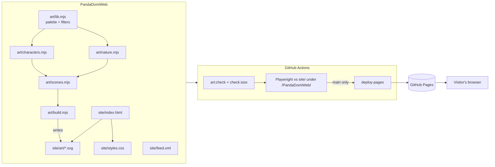

# Feature: Landing page (Phase 0)

## Problem, in parent terms

A relative or friend hears "we're making a panda journal app" and opens a link. In under a
minute they should understand three things without anyone explaining: you share a *moment* as a
cute panda card, never a photo of your child; the cub grows up and one day becomes the child's to
play; and it is safe (offline, no accounts, no tracking, no shop for children). If they want to
hear more, they can follow along without giving an email address.

Roadmap gate for Phase 0: the page is live on Pages, loads with **zero third-party requests**, and
someone in the family understands the idea from it without explanation.

## Decisions

| Decision | Why |
|:--|:--|
| Plain static HTML + CSS, **no JavaScript** | Nothing to phone home, nothing to keep state, nothing to break offline. The scroll scene (morning → day → sunset → night) is done with section backgrounds. |
| Art **drawn in code** as SVG (`art/*.mjs` → `site/art/*.svg`) | The page "needs its own art" now, before any images are generated. Code-drawn art follows `STYLE.md` (palette, warm dark-brown wobbly pencil lines, watercolour washes on cream paper, red panda markings, light from upper left) and is consistent by construction: one set of filters, one character module. Reproducible: `pnpm art:check` fails CI if the committed SVGs drift from the code. |
| Peek animation as CSS **inside** `shy-panda.svg` | Works in `` without script; `prefers-reduced-motion` inside the SVG shows the panda resting in place. |
| System fonts only | No font download, no third-party request. |
| Follow along = an **Atom feed** (`feed.xml`) | Answers the roadmap's open question with the only option that needs no email, no account and no server: the reader's feed app polls a static file. |
| No external links at all | Nothing to leak a referrer to, and the page practices what child mode will: no links out. |
| Served and tested under `/PandaDomiWeb/` | Same path as GitHub Pages, so relative URLs are tested as deployed. |
| Everything under `.pd-grove`, `pd-` classes | The scene must later move into the Domi villa site as the bamboo grove without a redesign. |

## Architecture

## Risk analysis

**Privacy surface.** Every byte that can leave the visitor's device: the HTTP requests for the
page's own files, to GitHub Pages. GitHub sees IP addresses and user agents like any host; the page
says so in its small print. No third-party origin is contacted (tested). No cookies, no storage, no
script (tested). `referrer` is `no-referrer`. There are no outbound links, so no referrer to leak.
A CSP `<meta>` allows only same-origin images and styles and no scripts at all (`default-src
'none'`). The feed is fetched by the visitor's own reader; we learn nothing.

**Content privacy (the repo is public).** No family research, no real quotes, no names, no due
date. The three example cards are invented. Nothing personal appears in source or copy.

**Child safety.** The page is for grown-ups, but it still has no purchase, no link out, no form,
no free text from anyone and no input element of any kind (tested).

**Offline failure modes.** Not a PWA: there is no service worker on purpose (Phase 0 is a static
page; adding one would bring the stale-worker trap for no gain). Offline, the browser cache serves
it or it doesn't load — nothing half-works.

**Writes to `events`.** None. This repository has no app and no storage.

**Art.** Code-drawn SVG is not the final painted style the roadmap expects from the generation
pipeline. It is on-palette and on-style, but simpler. When painted layers are accepted (2560×1440
landing layers per `STYLE.md` §5), they replace the SVGs file-for-file with the same names.

**Performance.** SVG filters (turbulence, displacement, morphology) are rasterised once per image
on decode. Total site ≈ 392 KB raw, ≈ 43 KB gzipped. Not measured on a low-end phone.

## Gap analysis

- No painted art yet; no character sheets in this repo (they belong to the art pipeline in
  PandaDomi).
- No Gitea mirror for this repository yet.
- Only Chromium is tested. Safari and Firefox rendering of the filters is unverified.
- The family-understands-it half of the gate is a person, not a test.

## Verification matrix

| Case | Kind | Where |
|:--|:--|:--|
| No request to any other origin, page actually loaded ≥10 of its own SVGs | e2e | `loads nothing from any other origin` |
| No 4xx/5xx, no failed request | e2e | `every file it asks for exists` |
| Every picture decodes (none broken) | e2e | `every picture draws` |
| No console error/warning, no CSP violation | e2e | `no console errors or security policy violations` |
| Story, three cards each with the "made with" mark, promise, feed link | e2e | `tells the whole story` |
| No `<script>`, no form/input/video/iframe/embed | e2e | `runs no script and offers no way to send anything` |
| No cookies, localStorage, sessionStorage, IndexedDB | e2e | `leaves nothing behind in the browser` |
| No link leaves the site | e2e | `every link stays on this site` |
| Every `` has alt; ≥9 real descriptions | e2e | `every picture is described or marked decorative` |
| Skip link first on Tab, moves focus to the story | e2e (desktop) | `the skip link is the first stop for the keyboard` |
| 360 px phone: no sideways scroll and nothing cut off at the edges | e2e | `fits a small phone without sideways scrolling` |
| Feed is well-formed Atom with its entry | e2e | `the news feed is well-formed Atom` |
| Committed SVGs match the drawing code | CI | `pnpm art:check` |
| No file over 5 MB | CI + hook | `pnpm check:size` |
| Reduced motion: panda rests without the peek | manual | OS setting, reload |
| Someone in the family understands it unaided | manual | the Phase 0 gate |
| Zero third-party requests in a real browser's DevTools | manual | the Phase 0 gate |

Every e2e test runs in two projects (desktop Chrome, Pixel 7), against `site/` served under
`/PandaDomiWeb/`.
