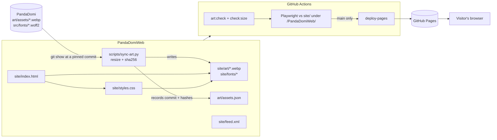

# Feature: Landing page (Phase 0)

## Problem, in parent terms

A relative or friend hears "we're making a panda journal app" and opens a link. In under a
minute they should understand three things without anyone explaining: you share a *moment* as a
cute panda card, never a photo of your child; the cub grows up and one day becomes the child's to
play; and it is safe (offline, no accounts, no tracking, no shop for children). If they want to
hear more, they can follow along without giving an email address.

Roadmap gate for Phase 0: the page is live on Pages, loads with **zero third-party requests**, and
someone in the family understands the idea from it without explanation.

## Decisions

| Decision | Why |
|:--|:--|
| Plain static HTML + CSS, **no JavaScript** | Nothing to phone home, nothing to keep state, nothing to break offline. The scroll runs from a morning valley to a night footer with section backgrounds. |
| Art is the **game's accepted art**, synced, not drawn here | Round 2 replaced the code-drawn SVGs with the painted assets accepted in PandaDomi (`art/assets/*.webp`, status `accepted` in its `assets.json`). `art/assets.json` here lists the 23 the landing uses and the width each is shown at; `scripts/sync-art.py` reads them with `git show` at a pinned PandaDomi commit (never uncommitted work), resizes them for the web (never enlarges) and records a sha256 per file. `pnpm art:check` fails CI if a file drifted, is missing, is not from the game, is referenced but not shipped, or is shipped but unused. |
| Cards and keepsakes follow the game's real templates | Each example card uses its template's art and den decoration (`first-steps` → `cub-walking` + `tiny-footprints`, `funny-moment` → `cub-tumble` + `paper-crown`, `child-said` → `cub-speaking` + `speech-bubble-note`) on `card-bg-meadow` at 9:16, laid out like the game's `MomentCard`. The shelf shows eight decorations captioned with the template titles they come from. |
| Hero: the game's 16:9 stage of three layers, the shy panda peeks from a clipped window | Sky, valley and grove cover the hero without being squashed: a phone shows the middle of the painting, a wide screen all of it. The panda slides out of a window that starts at the trunk's right edge (the game's own coordinates). CSS only; `prefers-reduced-motion` shows it resting in place. |
| The game's own fonts, self-hosted | Baloo 2 800 for headings, Nunito for text, copied with their OFL licences, so the landing and the app read as one product. `font-src 'self'` in the CSP. |
| Follow along = an **Atom feed** (`feed.xml`) | Answers the roadmap's open question with the only option that needs no email, no account and no server: the reader's feed app polls a static file. |
| No external links at all | Nothing to leak a referrer to, and the page practices what child mode will: no links out. |
| Served and tested under `/PandaDomiWeb/` | Same path as GitHub Pages, so relative URLs are tested as deployed. |
| Everything under `.pd-grove`, `pd-` classes | The scene must later move into the Domi villa site as the bamboo grove without a redesign. |

## Architecture

## Risk analysis

**Privacy surface.** Every byte that can leave the visitor's device: the HTTP requests for the
page's own files, to GitHub Pages. GitHub sees IP addresses and user agents like any host; the page
says so in its small print. No third-party origin is contacted (tested). No cookies, no storage, no
script (tested). `referrer` is `no-referrer`. There are no outbound links, so no referrer to leak.
A CSP `<meta>` allows only same-origin images and styles and no scripts at all (`default-src
'none'`). The feed is fetched by the visitor's own reader; we learn nothing.

**Content privacy (the repo is public).** No family research, no real quotes, no names, no due
date. The three example cards are invented. Nothing personal appears in source or copy.

**Child safety.** The page is for grown-ups, but it still has no purchase, no link out, no form,
no free text from anyone and no input element of any kind (tested).

**Offline failure modes.** Not a PWA: there is no service worker on purpose (Phase 0 is a static
page; adding one would bring the stale-worker trap for no gain). Offline, the browser cache serves
it or it doesn't load — nothing half-works.

**Writes to `events`.** None. This repository has no app and no storage.

**Art.** Only art with status `accepted` in the game can be synced (the script refuses
placeholders). Assets the page waits for are listed under `pending` until the game accepts them. The art is pinned: when the game accepts new or
changed art, nothing here moves until someone re-runs the sync and commits.

**Performance.** About 2.4 MB of WebP in total, of which about 0.9 MB is the opening scene (sky,
valley, grove, panda); everything below it is `loading="lazy"`. Fonts about 108 KB. Not measured on
a low-end phone or a slow connection.

## Gap analysis

- The painted night arrived (game commit `3329689`): the footer is now `valley-night` full-bleed,
  fading in from the dusk and out into a night-meadow band, with `owl-storytelling` telling the
  story and the sleeping cub in the meadow. Nothing is pending.
- No Gitea mirror for this repository yet.
- Only Chromium is tested. Safari and Firefox are unverified.
- The family-understands-it half of the gate is a person, not a test.

## Verification matrix

| Case | Kind | Where |
|:--|:--|:--|
| No request to any other origin; the page actually loaded ≥20 of its WebP files and ≥2 fonts | e2e | `loads nothing from any other origin` |
| No 4xx/5xx, no failed request | e2e | `every file it asks for exists` |
| Every picture decodes (none broken) | e2e | `every picture draws` |
| No console error/warning, no CSP violation | e2e | `no console errors or security policy violations` |
| Name, headline, three story plates, eight keepsakes, three cards each with the "made with" mark, five promises, feed link | e2e | `tells the whole story` |
| No `<script>`, no form/input/video/iframe/embed | e2e | `runs no script and offers no way to send anything` |
| No cookies, localStorage, sessionStorage, IndexedDB | e2e | `leaves nothing behind in the browser` |
| No link leaves the site | e2e | `every link stays on this site` |
| Every `` has alt; ≥9 real descriptions | e2e | `every picture is described or marked decorative` |
| Skip link first on Tab, moves focus to the story | e2e (desktop) | `the skip link is the first stop for the keyboard` |
| 360 px phone: no sideways scroll and nothing cut off at the edges | e2e | `fits a small phone without sideways scrolling` |
| Feed is well-formed Atom with its entry | e2e | `the news feed is well-formed Atom` |
| Art and fonts match the hashes recorded at the sync; nothing missing, stray, unreferenced or unused | CI | `pnpm art:check` |
| No file over 5 MB | CI + hook | `pnpm check:size` |
| Peek runs normally; with reduced motion the panda is already out from behind the trunk | e2e | `the shy panda peeks once, and rests in place when motion is reduced` |
| Baloo 2 and Nunito actually load (a wrong path would fall back silently) | e2e | `the game's own fonts are the ones in use` |
| On a phone the card row scrolls, and a keyboard can scroll it | e2e | `the cards can be scrolled with a keyboard on a phone` |
| Every piece of text clears WCAG AA against the pixels actually rendered behind it (paintings, haze, gradients included) | e2e | `every piece of text has enough contrast with what is behind it` |
| Someone in the family understands it unaided | manual | the Phase 0 gate |
| Zero third-party requests in a real browser's DevTools | manual | the Phase 0 gate |

Every e2e test runs in two projects (desktop Chrome, Pixel 7), against `site/` served under
`/PandaDomiWeb/`.
